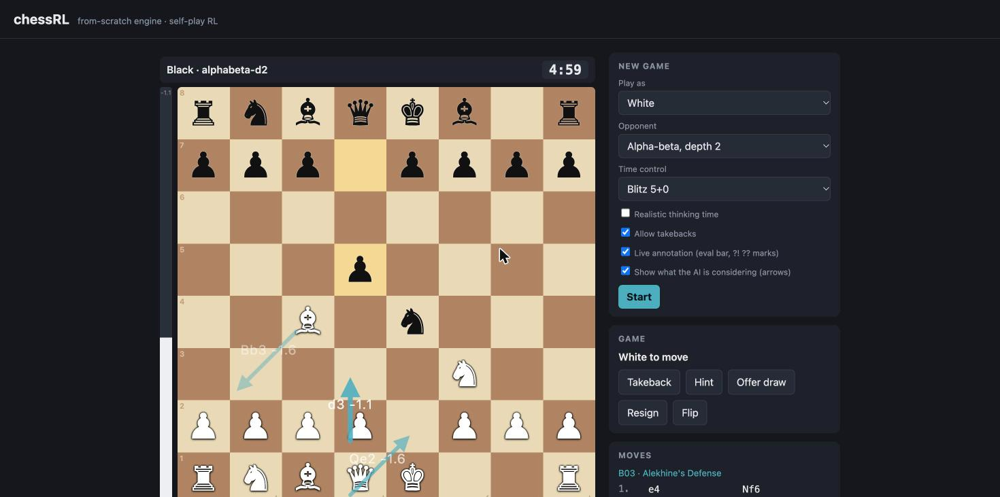
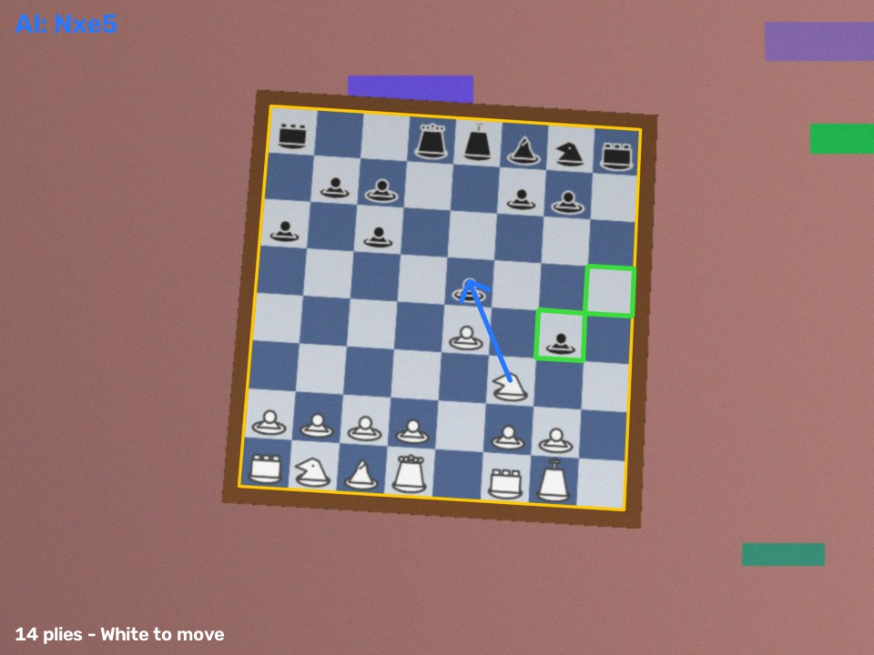

# chessRL

A chess engine written **from scratch** and a reinforcement-learning agent that learns to play it
**by self-play** — plus everything around it that makes it a real product: selectable Elo levels
with human-like timing and mistakes, a web interface with live annotation, post-game analysis, and
the ability to play on a **real board** through a camera.



> **Status.** All the pieces are implemented and tested (~170 tests). **No training run has been
> launched yet** — the self-play stack is ready and resumable (see [docs/TRAINING.md](docs/TRAINING.md));
> until then the playable opponents are the classical baselines and humanised alpha-beta levels.
> Results/Elo-vs-training curves will be added to the [report](docs/REPORT.md) after the first run.

## What's inside

| Area | What it does | Where |
|------|--------------|-------|
| **Engine** | legal moves, castling / en passant / promotion, all draw rules, FEN/UCI/SAN/PGN, Zobrist. Validated with perft (up to 4.08 M nodes) and differential tests against python-chess | `chessrl.engine` |
| **RL** | AlphaZero-style ResNet policy/value net, PUCT MCTS with batched leaf evaluation, parallel self-play, endgame curriculum, optional league play, compact replay buffer, **session-based training with atomic checkpoints** (stop/resume any time, Mac or Colab) | `chessrl.rl` |
| **Agents** | random, greedy, alpha-beta (quiescence, TT), MCTS+net, Stockfish/UCI wrapper | `chessrl.agents`, `chessrl.eval.uci` |
| **Evaluation** | arena with fair openings, MLE Elo with anchors, SPRT, Stockfish `UCI_Elo` calibration, snapshot Elo ladder + SVG curve | `chessrl.eval` |
| **Levels** | named Elo levels, human-like errors that depend on complexity and clock, think-time model, opening book (45 lines, ECO naming), style presets, adaptive difficulty | `chessrl.levels` |
| **Play** | clocks & time controls, resign / draw offers / takebacks / hints, terminal UI, web UI (drag & drop) | `chessrl.play`, `chessrl.web` |
| **Analysis** | win-probability accuracy per move, best/…/blunder classification, great & brilliant moves, critical moments, auto-annotated PGN, live annotation, "what the AI is considering" arrows | `chessrl.analysis` |
| **Vision** | camera → board detection → homography → still-frame detection → legal-move inference → PGN + AI suggestions; synthetic-data generator and YOLO training pipeline | `chessrl.vision` — [docs/VISION.md](docs/VISION.md) |
| **Browser demo** | the trained net running client-side with ONNX Runtime Web (JS port verified bit-exact against Python) | `docs/demo` |



## Quick start

```bash
python3.12 -m venv .venv && source .venv/bin/activate
pip install -e ".[dev,rl,vision,export]"

python -m chessrl serve                      # web UI at http://127.0.0.1:8000
python -m chessrl play --opponent level:Club # terminal game
python -m chessrl arena --a ab3 --b level:1400 --games 10
python -m chessrl analyse game.pgn --out annotated.pgn
python -m chessrl uci --agent level:1400     # use any agent in Arena / Cute Chess / lichess-bot
python -m chessrl vision-demo --rotate       # camera pipeline on a synthetic video

# train in resumable sessions (see docs/TRAINING.md)
python -m chessrl train --run runs/main --preset mac --iterations 20
python -m chessrl status --run runs/main
```

```python
from chessrl.engine import Board

board = Board()
board.push(board.parse_san("e4"))
print(board)                       # ASCII board
print(board.outcome())             # None while the game is running
```

## Tests

```bash
pytest -q                 # everything (≈ 4 min; stockfish-dependent tests skip if not installed)
pytest -q -m "not slow"   # quick pass
ruff check .
node docs/demo/test/test.js   # JS port vs Python (after `npm ci` in docs/demo/test)
```

## Documentation

* [Roadmap](docs/ROADMAP.md) — phases and status · [Ideas backlog](docs/IDEAS.md) — every idea, tracked
* [Decision log](docs/DECISIONS.md) — why things are the way they are
* [Training guide](docs/TRAINING.md) · [Evaluation & Elo](docs/EVALUATION.md) · [Vision](docs/VISION.md) · [Integrations (UCI, Lichess, browser)](docs/INTEGRATIONS.md)
* [Technical report (draft)](docs/REPORT.md) · [Model card template](docs/MODEL_CARD.md)

## Honest notes

* Elo figures are on the **Stockfish `UCI_Elo` scale at short move times** — a consistent relative
  scale, not FIDE/lichess Elo ([details](docs/EVALUATION.md)).
* The vision system is validated on **synthetic** footage; real cameras need tuning/fine-tuning.
* The engine is pure Python by design (clarity first); self-play still reaches ~8 k simulations/s on
  an Apple M5. A faster core is on the backlog (ENG-1/ENG-2).

## Author

Francisco Javier Gómez Pulido — AI Lead & Data Scientist. MIT licensed.
